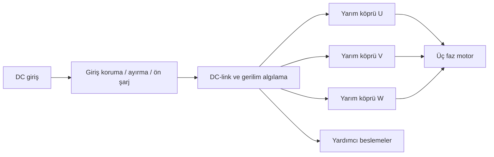
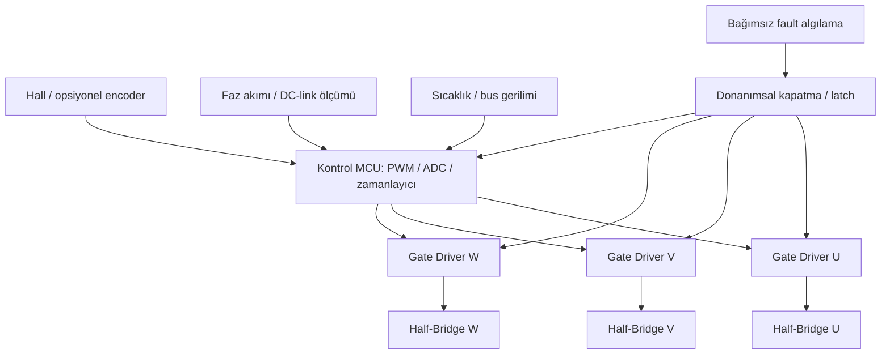

# Sistem blok diyagramları

Oklar işlevsel akışı gösterir; bunlar PCB routing'i ya da tamamlanmış elektrik şeması değildir.

## Güç akışı

## Kontrol, ölçüm ve fault

Yüksek taraf sürücü beslemesi faz düğümüne referanslı olabilir; tüm sürücüleri tek ortak toprak sembolüne indirgemeyin. Güvenli kapatma mantığı firmware'in zamanında tepki vermesine bağımlı olmamalıdır.
