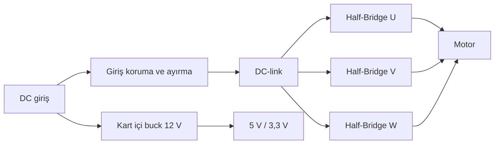
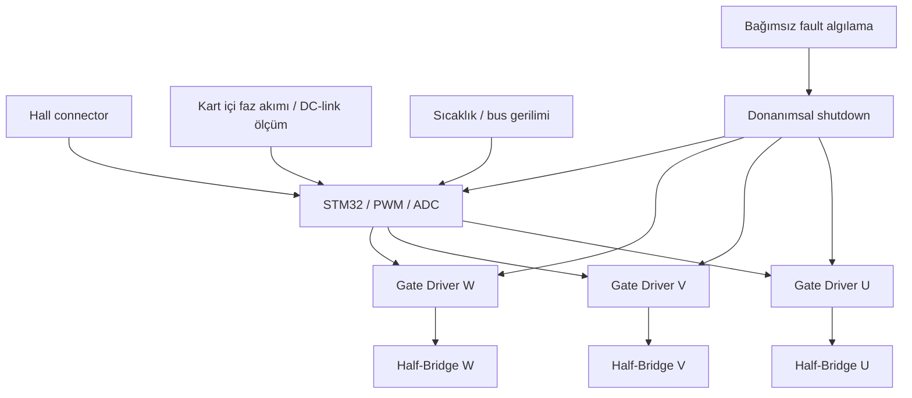

# Sistem blok diyagramları

Bu revizyonun geçerli ayrıntıları: [Entegre kart tasarım notu](09-integrated-board-revision.md). Diyagramlar işlevsel akıştır; elektrik şeması ve routing değildir.

Harici AUX, CAN, RS485 veya current-sense konnektörü bu kart revizyonunda yoktur. High-side besleme ve referansları gerçek gate-driver seçiminde ayrıca doğrulanmalıdır.
