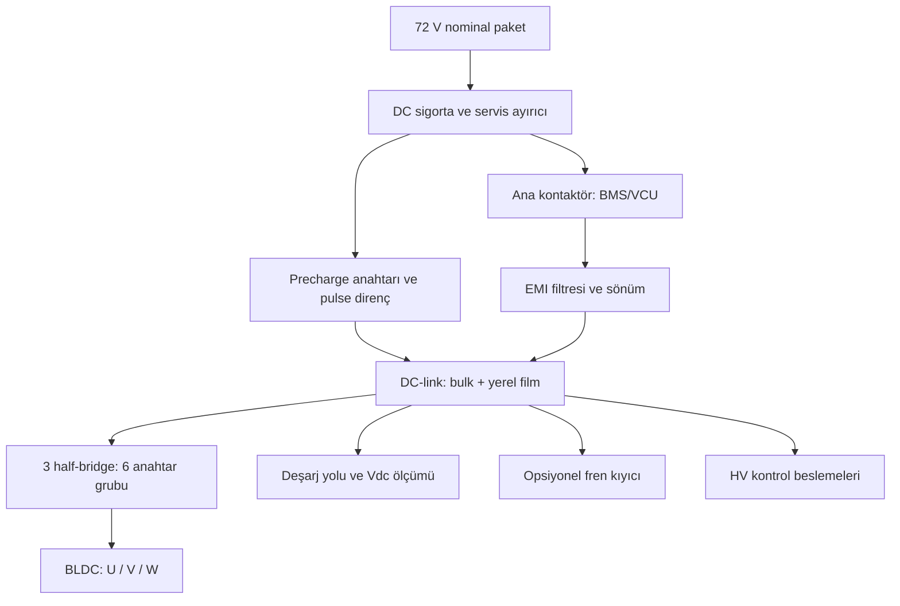
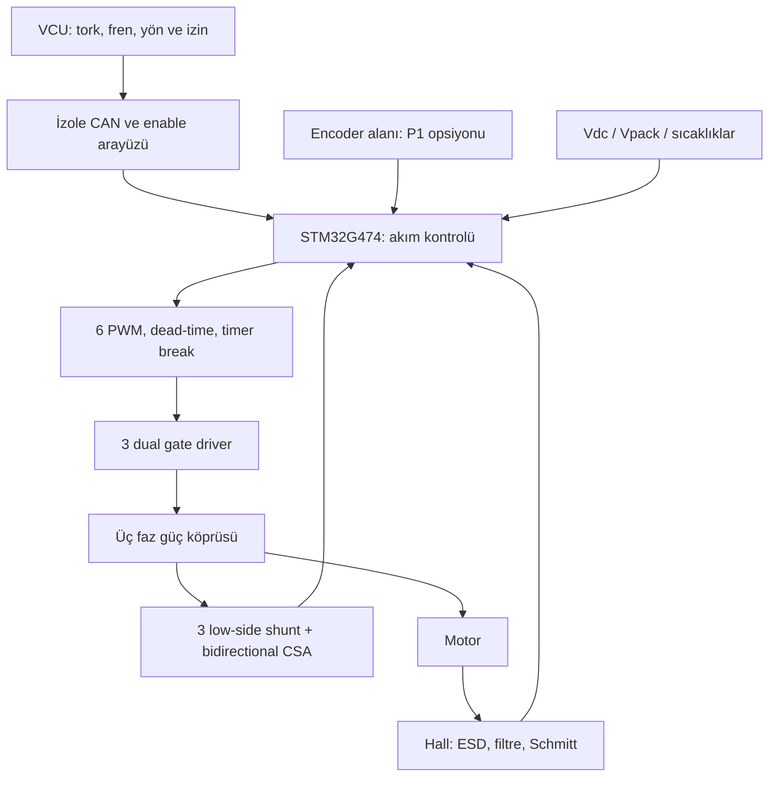
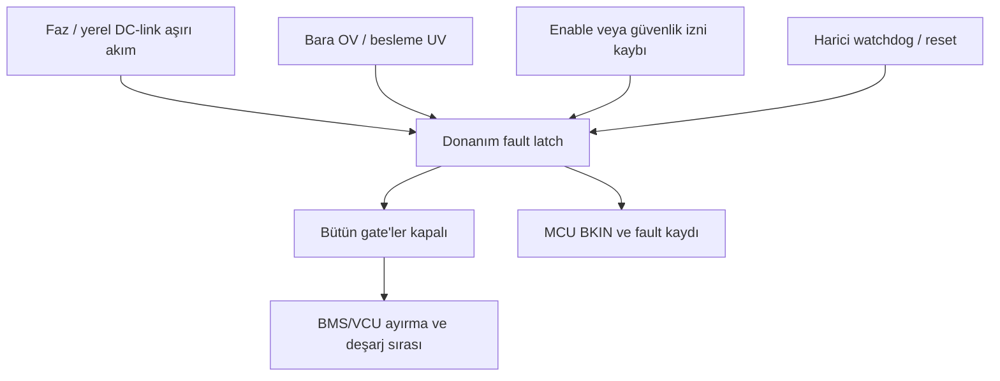

# Blok diyagramları

Bu diyagramlar elektriksel bağlantı seviyesinde şema değildir. Oklar güç veya bilgi akışını gösterir. High-side beslemeler kendi faz source'una referanslıdır.

## Güç yolu

Precharge'ın filtreye göre bağlantı noktası tam şemada belirlenir. Yukarıdaki çizimde DC-link'e ayrı giriş gösterilmiştir; filtrenin enerji depolayan elemanları ve bütün bus kapasitörlerinin güvenli dolması ayrıca analiz edilir. BAT− dönüşü DC-link/low-side shunt güç dönüşündedir; araç şasisi ile ortak bağlantı gösterilmemiştir.

## Kontrol ve geri besleme

## MCU'dan bağımsız kapatma

Gate-off her durumda fiziksel olarak sıfır tork garantisi değildir: diyot doğrultması, arızalı kısa MOSFET ve mekanik enerji ayrıca incelenir. Kontaktörün DC kesme yeteneği ve normal/acil açma senaryoları ayrı belirlenir.

## Elektriksel referans alanları

| Alan | Referans | Elemanlar | Diğer alana geçiş |
|---|---|---|---|
| Araç LV | LV GND / tanımlı şasi mimarisi | VCU, pedal, kullanıcı I/O, CAN bus tarafı | İzole veri ve gerekli izole güç |
| HV kontrol | BAT− | MCU, low-side CSA, gate kontrol girişi, HV auxiliary | LV'ye doğrudan GND/USB/pedal köprüsü yok |
| HS-U / HS-V / HS-W | İlgili faz source | High-side driver çıkışı ve yüzer 12 V | Driver bariyeri ve her faz için bağımsız besleme |
| Muhafaza | Araç şasisi | Metal kasa, ekran sonlandırmaları | HV bakırı ve MOSFET tabları yalıtılır |

## Yazılım bloklarının görevi

| P0 | P1 |
|---|---|
| Hall sector → six-step tablo → akım kontrolü → PWM | Rotor açısı + faz akımları → Clarke/Park → d/q PI → inverse Park → SVPWM |

SVPWM komütasyon sensörü değildir; gerilim komutunu duty'ye çevirir. FOC rotor açısı ve akımları kullanarak gerilim komutunu hesaplar. Aynı kartın P1'e geçebilmesi için örnekleme, driver duty sınırları ve açı bilgisi P0'da hazırlanır.
