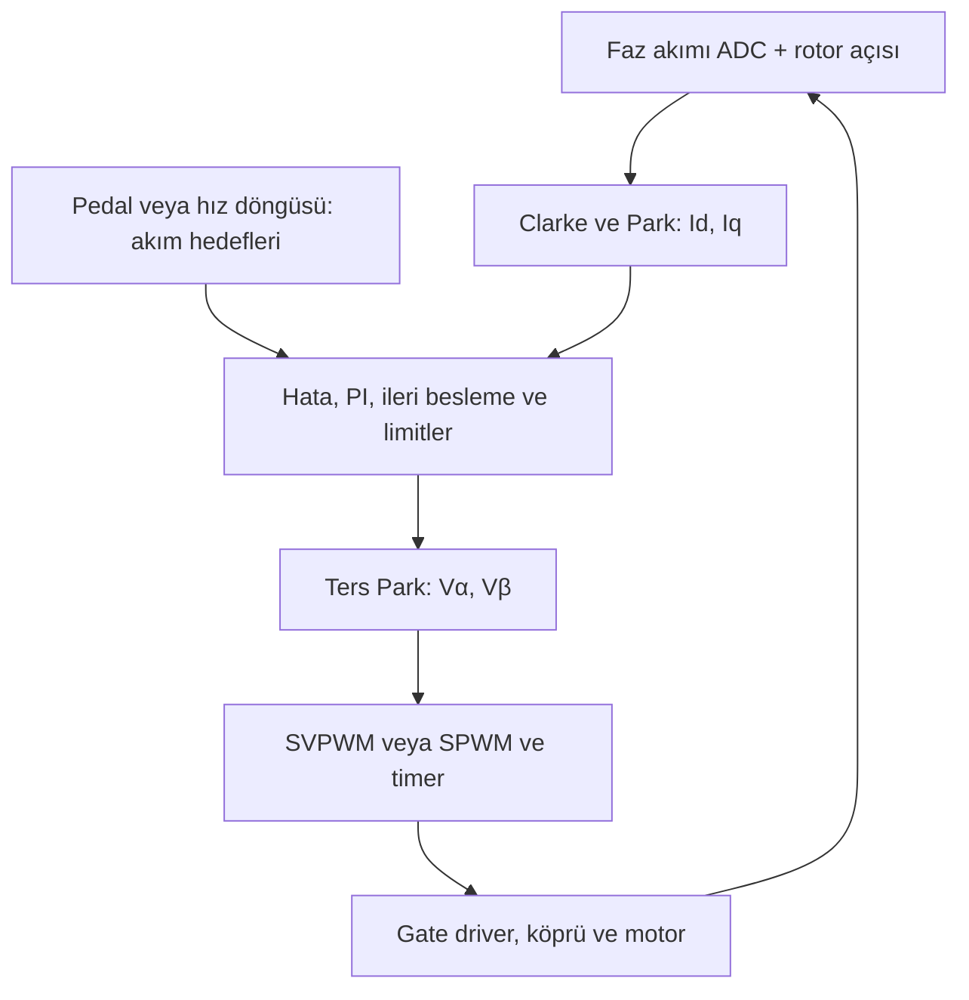

# BLDC sürüşü: six-step, FOC ve SVPWM

10 Ekim 2026. Bu sohbet ile kullanıcının yüklediği Gemini metninin düzeltilmiş teknik sentezidir. Sayısal örnekler öğretim içindir; gerçek motorun R, L, mıknatıs akı bağı, kutup çifti ve faz akımı henüz bilinmiyor. Kaynaklar [C01–C06](05-sources.md), hataların dökümü [teknik denetim](07-conversation-audit.md).

## 1. Motor neden döner?

Rotor mıknatısları ve stator akımları manyetik alan oluşturur. Statorun ürettiği alan rotor alanına göre uygun açıdayken elektromanyetik tork doğar. Sabit bir sargı çiftini sürekli beslemek rotoru bir denge konumuna çeker; sürekli dönüş için stator alanının yönünü rotor ilerledikçe değiştirmek gerekir. Six-step bunu adımlarla, FOC ise rotor açısına göre sürekli hesaplanan akım vektörüyle yapar.

U→W sürüşünde akım U terminalinden girer, bağlı sargılar üzerinden W terminalinden çıkar; U ve W'nin alanlarının bileşkesi oluşur. Üç kablolu motorda tek faza bağımsız akım uygulamak için ayrı bir nötr dönüşü yoktur. Yıldız/üçgen bağlantı bilinmeden iç sargı akımı ile kablo akımı aynı kabul edilmez.

Fazlar arasındaki 120° **elektriksel** açıdır. Kutup çifti sayısı p ise:

`θe = wrap(p × θm + θoffset)`; `ωe = p × ωm`; `fe = p × rpm / 60`.

Bu dokümanda θ, elektriksel rotor açısıdır. Manyetik akı, akı bağı ve elektrik alan farklı büyüklüklerdir. ψ akı bağıdır (Wb, sarım etkisi dahil); geri EMK e bir gerilimdir (V).

## 2. Üç kavram aynı düzeyde değildir

| Kavram | Ne yapar? | Geri besleme / gereksinim | Çıkışı |
|---|---|---|---|
| Six-step, 120° iletim | Rotor sektörüne göre iki fazı sürer, üçüncü fazı komutla sürmez | P0'da 3 dijital Hall; ayrıca kapalı çevrim akım ve donanımsal koruma | Aktif faz çifti ve PWM duty |
| FOC | Rotor eksenlerindeki Id ve Iq akımlarını regüle eder | Geçerli faz akımı ölçümü, elektriksel açı ölçümü/tahmini, gerçek zamanlı kontrol | Vd/Vq gerilim komutları |
| SVPWM | İstenen stator gerilim vektörünü anahtarlama sürelerine çevirir | Vα/Vβ, ölçülen Vdc, PWM periyodu ve inverter sınırları | Üç kolun duty değerleri / anahtarlama dizisi |
| SPWM | Faz gerilim hedeflerini taşıyıcı ile karşılaştırır | Üç gerilim hedefi, Vdc ve PWM timerı | Üç kolun duty değerleri |

FOC + SVPWM yaygın birleşimdir; FOC + SPWM de çalışır. SVPWM, FOC olmadan başka gerilim komutlarını da uygular. SVPWM bloğunun kendisi Hall istemez; ona komut veren motor kontrol algoritmasının konum ihtiyacı ayrı konudur. Six-step sensörsüz geri-EMK komütasyonu da mümkündür; ilk prototipin seçimi Hall'dur.

## 3. Six-step nasıl anahtarlar?

Aşağıdaki sıra yalnız örnektir; gerçek Hall bit sırası, polarite ve faz bağlantısı ölçülerek eşlenmelidir.

| Elektriksel sektör | Akım giren faz | Akım çıkan faz | Komutla sürülmeyen faz |
|---|---|---|---|
| 1 | U | V | W |
| 2 | U | W | V |
| 3 | V | W | U |
| 4 | V | U | W |
| 5 | W | U | V |
| 6 | W | V | U |

Her sektör 60° sürer. Bir faz ideal olarak +120°, boşta 60°, −120°, boşta 60° geçirir. Komütasyonda endüktans nedeniyle eski faz akımı hemen yok olmaz; diyotlar ve MOSFET'ler üzerinden dolaşım/örtüşme olabilir. Boşta fazın potansiyeli zorunlu olarak 0 V değildir.

Six-step %100 duty olmak zorunda değildir. PWM ve akım PI kontrolüyle aktif faz çifti akımı düzenlenebilir. Gazı doğrudan duty'ye eşlemek ile akım/tork isteğine eşlemek farklı kontrol seçimleridir. P0 önerisi akım geri beslemeli six-step'tir.

## 4. Id ve Iq fiziksel olarak ne?

d ekseni rotor mıknatıs akısına hizalı, q ekseni ona 90 elektriksel derece diktir. Bu eksenler rotorla döner. Id/Iq ayrı kablolar değildir; aynı üç faz akım vektörünün iki izdüşümüdür.

Sinüzoidal temel bileşenli PMSM modeli:

`ψd = ψm + Ld Id`; `ψq = Lq Iq`

`Te = (3/2) p [ψm Iq + (Ld − Lq) Id Iq]`.

Yüzey mıknatıslı motorda Ld≈Lq olduğunda `Te ≈ (3/2) p ψm Iq`. Böylece Iq torkun başlıca kontrol değişkenidir. Id=0, bu modelde sabit akım büyüklüğü için uygun tork üretimini sağlar; motor her zaman maksimum torkta çalışıyor demek değildir. Gerçek tork Iq isteği ve gerilim/akım/sıcaklık sınırlarıyla belirlenir. Salient/IPM motorlarda relüktans torku nedeniyle MTPA için Id sıfırdan farklı olabilir.

Id değişince q ekseninin yönü değişmez. **Toplam akım vektörünün** büyüklüğü ve d eksenine göre açısı değişir:

`Is = sqrt(Id² + Iq²)`; `γ = atan2(Iq, Id)`.

Toplam stator akı vektörü de bileşenlerin toplamıdır; onun yönü ile q eksenini aynı sayma. Negatif Id, mıknatısın akısına karşı armature reaction üretir; net d akı bağını azaltır. Kalıcı mıknatısın ψm değerini yazılımla geri dönüşümlü olarak ayarlayan bir alan sargısı yoktur.

## 5. Iq toplam tüketilen akım mı? Id hızı mı kontrol eder?

Hayır. Üç kablolu motorda ideal olarak `Ia + Ib + Ic = 0`; bu cebirsel toplam güç tüketimini göstermez. Bu dokümandaki genlik koruyan dönüşümle sabit Id/Iq ve dengeli sinüzoidal kararlı halde Is, faz akımının tepe genliğidir; `Iphase,rms = Is/√2`. Iq ancak Id=0 iken bu genliğe eşittir. Batarya/DC-link akımı farklıdır.

İdeal temel bileşen güç ilişkisi `P = (3/2)(Vd Id + Vq Iq)`; batarya tarafında ortalama güç yaklaşık `Vdc × Ibat` olup inverter kayıpları ve DC-link enerji değişimi de hesaba katılır. 72 V × 50 A = 3,6 kW elektriksel giriş örneğidir; 50 A faz RMS veya Iq=50 A anlamına gelmez.

Mekanik denklem `J dωm/dt = Te − Tload − Bωm`'dir. Tork artışı net tork pozitifse ivmeyi artırır; sabit hızda üretilen tork yükü dengeler. Hız regülatörü çoğunlukla Iq_ref üretir. **Id doğrudan hız komutu değildir**; alan zayıflatma ile yüksek hızda gerilim sınırını yönetmeye yardımcı olur.

## 6. FOC'nin bir çevrimi

1. Geçerli PWM penceresinde faz akımları ölçülür; aynı zamana karşılık gelen elektriksel açı belirlenir.
2. Clarke/Park ile **ölçülen** Id_meas/Iq_meas hesaplanır.
3. Pedal/VCU, limitlenmiş Iq_ref isteğini verir; P0 sonrası temel FOC'de Id_ref genellikle 0'dır.
4. Akım hataları PI kontrolcüye girer. Çıkışlar amper değil, volt biriminde gerilim komutlarıdır.
5. İleri besleme gerekiyorsa eklenir; gerilim vektörü sınırlanır ve integratör doyuma göre yönetilir.
6. Ters Park ve modülatör üç kolun anahtarlama sürelerini hesaplar.
7. Timer, dead-time ile komplementer PWM üretir; gate driver MOSFET gate'lerini source referansına göre sürer. Motor akımları değişir ve çevrim tekrar ölçer.

20 kHz öğretim örneğinde Ts=50 µs. Kesme yalnız rotor bir adım döndüğünde oluşmaz; kontrol periyodik timer/ADC olaylarıyla çalışır. Hall kenarları açı tahminini ayrıca günceller. Id/Iq, kararlı ve uygun model koşullarında yaklaşık sabittir; geçici halde, PWM ripple'ında veya açı hatasında dalgalanabilir.

## 7. Dönüşümler ve gerçek sayı örneği

**Genlik koruyan Clarke**, üç kablo akım toplamı sıfır varsayımıyla:

`Iα = Ia`; `Iβ = (Ia + 2 Ib)/√3`.

**Park**:

`Id = Iα cosθ + Iβ sinθ`

`Iq = −Iα sinθ + Iβ cosθ`.

**Ters Park**:

`Iα = Id cosθ − Iq sinθ`

`Iβ = Id sinθ + Iq cosθ`.

**Ters Clarke**:

`Ia = Iα`; `Ib = −Iα/2 + √3 Iβ/2`; `Ic = −Iα/2 − √3 Iβ/2`.

Gerilimler için aynı dönüşüm uygulanır. Akımın ters dönüşümü burada hedef dalga şeklini **açıklamak** içindir; standart FOC'nin PI çıkışı gerilimdir. Güç koruyan başka ölçek kullanılırsa genlik, güç ve tork katsayıları birlikte değiştirilmelidir.

| θe | Id | Iq | Ia | Ib | Ic |
|---|---:|---:|---:|---:|---:|
| 0° | 0 A | 10 A | 0 A | +8,660 A | −8,660 A |
| 90° | 0 A | 10 A | −10 A | +5 A | +5 A |
| 180° | 0 A | 10 A | 0 A | −8,660 A | +8,660 A |
| 270° | 0 A | 10 A | +10 A | −5 A | −5 A |

Iq sabitken rotor açısı değiştiği için kablo akımları sinüzoidal olur. Rotor duruyorsa açı sabittir ve sabit tork için faz akımları yaklaşık sabit olabilir; FOC'nin her koşulda zamanla sinüs üretmesi gerekmez.

Ters yöndeki örnek: θ=30°, Ia=−3,268 A, Ib=+10 A, Ic=−6,732 A ölçülsün. Clarke Iα=−3,268 A, Iβ=9,660 A; Park yaklaşık **Id=2 A, Iq=10 A** verir. Id=2 A ayrı bir sensörden okunmuş değildir; ADC akımlarının açıya göre dönüşüm sonucudur.

## 8. Gaz pedalı nasıl Iq_ref olur?

Eğitim örneği: kabul edilmiş tek kanal pedal aralığı 0,5–2,8 V ve varsayımsal Iq_max=50 A olsun:

`u = clamp((Vpedal − 0,5)/(2,8 − 0,5), 0, 1)`

`Iq_ref_raw = u × Iq_max`.

Vpedal=0,96 V için u=0,2 ve Iq_ref_raw=10 A olur. Motorun şu an gerçekten 10 A q akımı çektiği anlamına gelmez. Iq_meas, faz akımları ve açıdan hesaplanır; PI bu iki sayının farkını kapatmaya çalışır.

Araç uygulamasında bu basit örnek nihai pedal mimarisi değildir: iki kanalın uyumu, kopukluk/sıkışma, fren-gaz uyuşmazlığı, VCU izni, hız/termal/BMS sınırları ve komutun değişim hızı değerlendirilir. ADC ölçeği gerçek referans gerilimiyle kalibre edilir; doğrudan 0–4095 sayısını güvenilir tam gaz saymak yeterli değildir. Donanım izolasyonu [tasarım kılavuzundaki](02-hardware-guide.md) LV/HV mimarisiyle uyumlu olmalıdır.

## 9. Vd/Vq nasıl hesaplanır? Ayrık PI

Her eksen için `e[k] = Iref[k] − Imeas[k]`:

`x[k] = x[k−1] + Ki × Ts × e[k]`

`VPI[k] = Kp × e[k] + x[k]`.

Kp birimi V/A, Ki birimi V/(A·s), x birimi V'dur. Ki_d=Ki×Ts önceden hesaplanmışsa kodda tekrar Ts çarpılmaz; hangi tanımın kullanıldığı açık yazılmalıdır.

Gemini'deki sayıların **aynı Ki birimiyle düzeltilmesi**: Iq_ref=10 A, Iq_meas=6 A, Kp=0,8 V/A, Ki=0,05 V/(A·s), Ts=50 µs, x_eski=2,5 V:

- e=4 A, P=3,2 V.
- Δx=0,05×0,00005×4 = **0,00001 V**.
- x_yeni=2,50001 V; Vq_PI=**5,70001 V**, 5,9 V değildir.

5,9 V ancak 0,05 sayısı Ki_d (V/A, her örnekte integral artışı) olarak tanımlanırsa çıkar; o durumda sürekli zaman Ki=1000 V/(A·s) olur. Bunlar gerçek motor için önerilen kazançlar değildir.

İdeal ayrıştırılmış RL akım modeli için başlangıç tasarım ilişkisi `Kp≈L ωc`, `Ki≈Rs ωc` olabilir; ADC/PWM gecikmesi, elektriksel frekans, gürültü, doyum ve gerçek L/R ile kararlılık doğrulanmadan uygulanmaz. Hız döngüsü akım döngüsünden daha yavaş tasarlanır.

Sinüzoidal PMSM dq gerilim denklemleri:

`Vd = Rs Id + Ld dId/dt − ωe Lq Iq`

`Vq = Rs Iq + Lq dIq/dt + ωe(Ld Id + ψm)`.

Bu işaret konvansiyonuyla ileri besleme: `Vd_ff=−ωe Lq Iq`, `Vq_ff=ωe(Ld Id+ψm)`. Uygulanacak toplam komut VPI+Vff'dir. Bağlaşım terimleri hız **sabitken de** vardır. Feedforward model hatası varsa ideal ayrışma sağlamaz.

**Doyum ile anti-windup farklıdır.** `sqrt(Vd²+Vq²)>Vlim` ise iki bileşeni birlikte ölçeklemek gerilim sınırlamasıdır. Anti-windup integratörün uygulanamayan komutu biriktirmesini önler; conditional integration veya back-calculation kullanılabilir. Back-calculation örneği `dx/dt=Ki e+Kaw(Vsat−Vunsat)`; Kaw birimi 1/s. İleri besleme dahil toplam vektör doyumu her eksene doğru geri bildirilmelidir.

## 10. PWM gerilimi nasıl sinüzoidal akım oluşturur?

MOSFET güç sürüşünde açık/kapalı kullanılır; fiziksel kenarlar sonlu süreli, ringing ve dead-time içerir. Faz düğümünün DC−'a göre gerilimi idealde 0/Vdc'dir. **Faz-faz** gerilimi −Vdc/0/+Vdc olabilir; **faz-nötr** gerilimi yüzen nötr nedeniyle farklıdır. Bir fazın MOSFET'i kapalı diye sargı gerilimi mutlaka 0 V olmaz.

Basitleştirilmiş faz modeli `di/dt=(vphase−Rs i−e)/L`'dir. Akımın eğimi yalnız Vdc/L değildir; uygulanan sargı gerilimi, geri EMK ve direnç düşümü belirler. Kısa PWM aralığında bu terimler yaklaşık sabitse ripple yaklaşık `Δi≈vL Δt/L` olur. Örneğin L=1 mH ve net endüktans gerilimi 10 V, 10 µs boyunca +0,1 A akım değişimi üretir; gerçek motor L'si olarak kullanılmaz.

Sinüs duty tablosu tek başına doğru akımı garanti etmez. PI, akımın hedef d/q bileşenlerini tutacak **gerilimi** hesaplar; endüktans hızlı ripple'ı sınırlar. Duty maksimumu akımın maksimumuyla aynı anda olmak zorunda değildir. SVPWM duty dalgasında common-mode eklemesi nedeniyle saf sinüs görünmeyebilir; hat geriliminin temel bileşeni ve akım yine sinüzoidal olabilir.

Gaz değişiminde Iq_ref ve sonra Iq_meas değişir; faz akımının genliği geçiş yapar. Endüktans nedeniyle faz akımı aniden sıçramaz. Her kolun aynı anda %99 duty olması büyük tork komutu değildir: üç kol eşitse hat gerilimi sıfır olur. İstenen **vektörün** gerilim sınırı önemlidir.

## 11. SVPWM'nin sekiz durumu

S_U/S_V/S_W=1 üst MOSFET açık, alt kapalı; 0 alt açık, üst kapalı demektir. Bu ideal durum tablosu dead-time aralıklarını kapsamaz.

| Durum | Vektör açısı | Genlik |
|---|---:|---:|
| 100 | 0° | 2Vdc/3 |
| 110 | 60° | 2Vdc/3 |
| 010 | 120° | 2Vdc/3 |
| 011 | 180° | 2Vdc/3 |
| 001 | 240° | 2Vdc/3 |
| 101 | 300° | 2Vdc/3 |
| 000, 111 | Merkez | 0 |

000 **bütün gate'ler kapalı** değildir: üç alt MOSFET açıktır. 111'de üç üst açıktır. Her iki durumda hat gerilimleri sıfırdır fakat common-mode gerilimleri farklıdır. Motor uçları aynı raya bağlanmıştır; akım serbest dolaşabilir. Dönen motorun EMK'sı akımı değiştirebilir; sıfır vektöründe akım her koşulda yalnız sönümlenir denmez. Tüm gate'leri kapatmak farklı bir durumdur; diyot iletimi ve bus şarjı olabilir.

Birinci sektörde V1=100 ve V2=110 arasında α∈[0,π/3]:

`T1 = Ts (√3 |Vref|/Vdc) sin(π/3−α)`

`T2 = Ts (√3 |Vref|/Vdc) sin(α)`; `T0 = Ts−T1−T2`.

Zaman ortalaması `Vref=(T1 V1+T2 V2)/Ts` olur. Vektör büyüklükleri gerilimdir; doğrudan manyetik alan/tork değildir. Altı SVPWM sektörü, six-step'in altı komütasyon adımıyla aynı sürüş değildir: SVPWM her PWM periyodunda süreleri yeniden sentezler.

### 72 V, 20 kHz, 20 V / 30° için tutarlı hesap

Ts=50 µs; aktif vektörler 48 V. T1=T2=**12,028 µs**, T0=**25,944 µs**.

Simetrik dizilim `000 → 100 → 110 → 111 → 110 → 100 → 000`; iki uç 000 parçalarının her biri T0/4, merkez 111 T0/2, her aktif parça ilgili sürenin yarısıdır. İdeal toplam üst gate duty değerleri:

`DU=(T1+T2+T0/2)/Ts=0,740563`

`DV=(T2+T0/2)/Ts=0,5`

`DW=(T0/2)/Ts=0,259437`.

Üst açık süreleri **37,028 / 25 / 12,972 µs**'dir. Faz-nötr ortalama hedefleri yaklaşık +17,321 / 0 / −17,321 V olur; Clarke vektörü (17,321; 10) V, yani tam 20 V / 30°'dir. Gemini'nin 15/15/20 µs örneği 20 V değil yaklaşık 24,94 V üretir.

## 12. 72 V sınırı ve alan zayıflatma

Bu genlik koruyan ölçekle ideal, dengeli, lineer modülasyonda:

| Modülasyon | Faz-nötr temel tepe / vektör limiti | 72 V örneği |
|---|---|---:|
| Saf SPWM, common-mode enjeksiyonsuz | Vdc/2 | 36 V |
| SVPWM | Vdc/√3 | 41,569 V |

SVPWM farkı yaklaşık %15,47 **lineer gerilim kullanımıdır**; %15,47 verim, tork, güç veya son hız garantisi değildir. Uygun ortak üçüncü harmonik enjeksiyonu/carrier tabanlı common-mode yöntemleri aynı gerilim kullanımına ulaşabilir. Üç telli sistemde ortak gerilim bileşeni ideal hat farkından çıkar; delta iç dolaşımı ve parazitik akımlar ayrıca değerlendirilir.

Limit anlık Vdc ölçümünden hesaplanır; 72 V nominal sabit yazılmaz. Dead-time, minimum darbe, ADC ölçüm penceresi ve gerilim düşümleri için marj bırakılır. Örneğin `Vlim=0,95 Vdc/√3` öğretim marjıyla 72 V'ta 39,491 V olur; %95 gerçek donanım için seçilmiş değer değildir.

Base speed, yalnız geri EMK=41,569 V eşitliğiyle kesin bulunmaz: Rs düşümü, çapraz terimler, gerekli akım ve inverter marjı dahil toplam Vd/Vq dikkate alınır. Negatif Id net ψd'yi azaltarak gerilim limitinde daha yüksek hıza izin verebilir. Fakat `Id²+Iq²≤Imax²` akım bütçesi nedeniyle Iq/tork alanı azalabilir; bakır kaybı ve demanyetizasyon riski artar. Sabit güç bölgesi sınırsız değildir. P0'da alan zayıflatma devre dışıdır.

## 13. Motor uyumu ve kontrol seçimi

Trapezoidal geri EMK'li BLDC'de uygun blok **akım** ile EMK eşleşmesi, sinüzoidal PMSM'de sinüzoidal akım ile EMK eşleşmesi düzgün tork için başlangıçtır. Gerilim dalgasının EMK ile aynı olması tek başına verimi belirlemez. Genel mekanik dönüşüm gücü `Pem=ea ia+eb ib+ec ic` ile incelenebilir.

Temel sinüzoidal FOC, trapezoidal EMK'li motorda çalışabilir ancak harmonik tork/akım etkileri kalır; sabit %5 ripple veya %100 verim söylenemez. Üçüncü harmonik/zero-sequence etkisi motorun bağlantısına bağlıdır. Motorun geometrisi yalnız eksenel/radyal akı veya mıknatıs köşesiyle sınıflandırılmaz.

Bu proje için P0: Hall + akım kontrollü six-step. P1: Hall tabanlı FOC + SVPWM, ölçülmüş parametreler ve açı kalibrasyonu. P2: ihtiyaç varsa encoder ve sonra kontrollü alan zayıflatma/regen. Aynı köprü kullanılabilir; ADC zamanlaması, bağımsız 6 PWM kontrolü, geçerli açı ve fault yolları baştan sağlanmalıdır. FOC araç için mevzuat tarafından tek zorunlu algoritma olarak kabul edilmemiştir; seçim ölçülen performans ve doğrulama sonucuyla yapılır.
