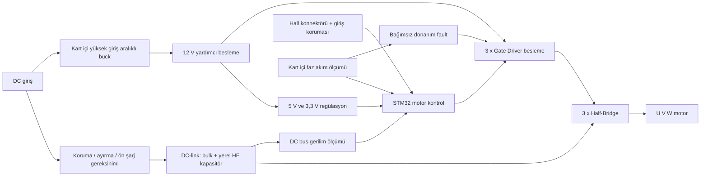

# Entegre sürücü kartı — yerleşim ve arayüz revizyonu

**Durum:** Görsel referansa dayalı konsept inceleme; onaylı şema, footprint, routing, termal hesap veya üretim çıktısı değildir.

## Kararlar
- Referans görseldeki **160 × 120 mm** üstten yerleşim, yalnızca ilk mekanik alan bütçesi olarak korunacak.
- Ayrı AUX supply kartı veya harici AUX besleme konnektörü **yok**. Girişten kart üzerinde bir buck ile 12 V yardımcı hat oluşturulması önerilir; ardından gerekli 5 V ve 3,3 V hatları kart içinde düzenlenir.
- **CAN ve RS485 devresi/konnektörü yok**. Harici **akım ölçüm konnektörü yok**; faz akım algılama devreleri ve ADC bağlantıları kart üzerinde kalır. FOC için akım geri beslemesini kaldırmak doğru değildir.
- Üç faz: her fazda bir half-bridge, iki güç MOSFET konumu ve bir çift çıkışlı bağımsız gate-driver. Toplam üç driver, altı MOSFET konumu. DRV ailesi bu taslakta aday değil.
- Hall motor sensör konnektörü ve gerekli koruması korunur. Sıcaklık sensörleri için gerekirse özel konnektör ayrılır; güç ve kontrol arayüzleri kesin şema ile netleşir.
- Görselde C1–C4 bankı konseptiktir: kesin kapasitans, ripple, gerilim sınıfı, boyut ve sayısı daha sonra hesaplanır. EMI bloğundaki CY gibi şasiye bağlantılar izolasyon izleme mimarisi netleşmeden otomatik eklenmez.

## Fonksiyonel bloklar

## Yerleşim bölgesi (görsele göre)

| Bölge | Referans konum | Düzenleme |
|---|---|---|
| DC giriş / koruma / EMI | Sol | Konnektör, ayırma, EMI için mekanik pay; koruma topolojisi henüz TBD |
| DC-link | Sol üst-orta | C1–C4 görsel rezervasyonu; yerel HF kondansatörler köprü komütasyon döngüsüne yakın |
| Buck ve düşük gerilim regülasyon | Üst sağın kenarında, MCU'dan ayrılmış güç alanı | Harici AUX J2 kaldırıldı; kart içi buck indüktör/anahtarlama döngüsü, kontrol ADC girişlerinden uzak |
| MCU | Üst sağ-orta | SWD/debug, Hall, PWM, ADC ve bağımsız fault hatlarına göre pin planı |
| Gate Driver U/V/W | Her half-bridge'in hemen üstü | Her biri kendi gate döngüsüne yakın; bootstrap/yüzer besleme konusu kontrol yöntemiyle beraber değerlendirilecek |
| Güç katı ve U/V/W çıkışları | Alt sıra | Üç dengeli yarım köprü; mekanik busbar/soğutucu konsepti gerçek paketlere göre doğrulanacak |
| Hall ve gerekli sensör bağlantıları | Sağ kenar | CAN, RS485, AUX ve harici current connector alanları kaldırılacak |

## Kart üstü yardımcı besleme değerlendirmesi

Önerilen güç ağacı: **DC giriş → yüksek giriş aralıklı buck → 12 V → 5 V → 3,3 V** (son iki kademe için LDO/buck seçimi kayıp ve güç bütçesine göre). Bu ifade buck entegresinin veya indüktörün kesin seçimi değildir. Giriş gerilimi yalnız nominal seviyeye göre değil maksimum DC giriş, rejenerasyon, kablo/parazitik transient ve koruma elemanlarının sınırlarıyla değerlendirilir. Gate-driver toplam ortalama yükü, MCU, Hall ve sensör akımları için ayrı bütçe çıkarılır. Sürücünün high-side yüzer beslemesi 12 V oluşturulunca otomatik çözülmez; referans ve çalışma süresi ayrıca analiz edilir.

Buck çevresinde öncelikle incelenecekler: giriş seramik/bulk ve gerilim dayanımı, UVLO/EN, switching düğümü, indüktör satürasyonu/ripple, serbest dolaşım yolu (topolojiye göre), çıkış kondansatörü ESR, FB direnç ağı, kompanzasyon (IC gerektiriyorsa), başlangıç akımı, termal ve EMI. Üretici datasheet uygulama şeması seçilmeden 100 nF/1 µF/10 µF konumlarını nihai değer diye sabitlemeyin.

## FOC + Six-Step donanım gereksinimleri

1. Bağımsız altı gate komutu veya seçilen sürücü arayüzü ile eşdeğer durumlar; tamamlayıcı PWM/dead-time ve asenkron shutdown.
2. Kart içi faz akımı ölçümü: üç kanal için yer/AFE ve senkron ADC planı; akım ölçümü kaybı güvenli fault.
3. Hall konnektörü ve giriş koruması; Hall sıra/ofset kalibrasyonu; gerekirse gelecekte daha hassas açı sensörüne MCU pin rezervasyonu.
4. DC-link gerilim ve güç elemanı sıcaklık izlemesi, watchdog ve firmware'den bağımsız donanım fault yolu.

## Kaldırılan harici arayüzler

- AUX supply konnektörü: kart üzerindeki buck ile değiştirildi.
- CAN konnektörü/transceiver: bu revizyonda yok.
- RS485 konnektörü/transceiver: bu revizyonda yok.
- Harici current-sense konnektörü: yok; ölçüm **dahili**.

## Tasarım açıkları / karar kapıları

- [ ] Motor ve güç katının gerçek çalışma/arıza zarfı, ölçüm ve termal sınırlar
- [ ] Buck regülatör aday datasheet ve güç bütçesi
- [ ] Buck ile gate driver yüksek taraf beslemesi uyumluluğu
- [ ] MOSFET/driver/şönt kesin MPN, paket, termal/soğutucu bağlantıları
- [ ] Hall, programlama, throttle/VCU, sıcaklık ve faz/giriş konnektörlerinin kesin pin listesi
- [ ] Precharge ve deşarjın kartta mı araçta mı olacağı
- [ ] Şasi/tra­ction dönüşü ve IMD izolasyon yaklaşımı
- [ ] Şematik ERC, fault tablosu, PCB DRC, üretici datasheet ve yetkin test incelemesi

Bu dosya **çalışan, doğrulanmış PCB iddiası değildir**. Görseldeki çizilmiş copper bar ve pinler elektriksel netlist olarak alınamaz.
