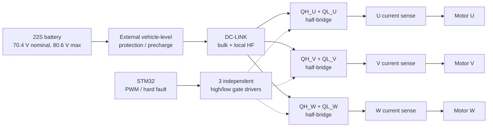
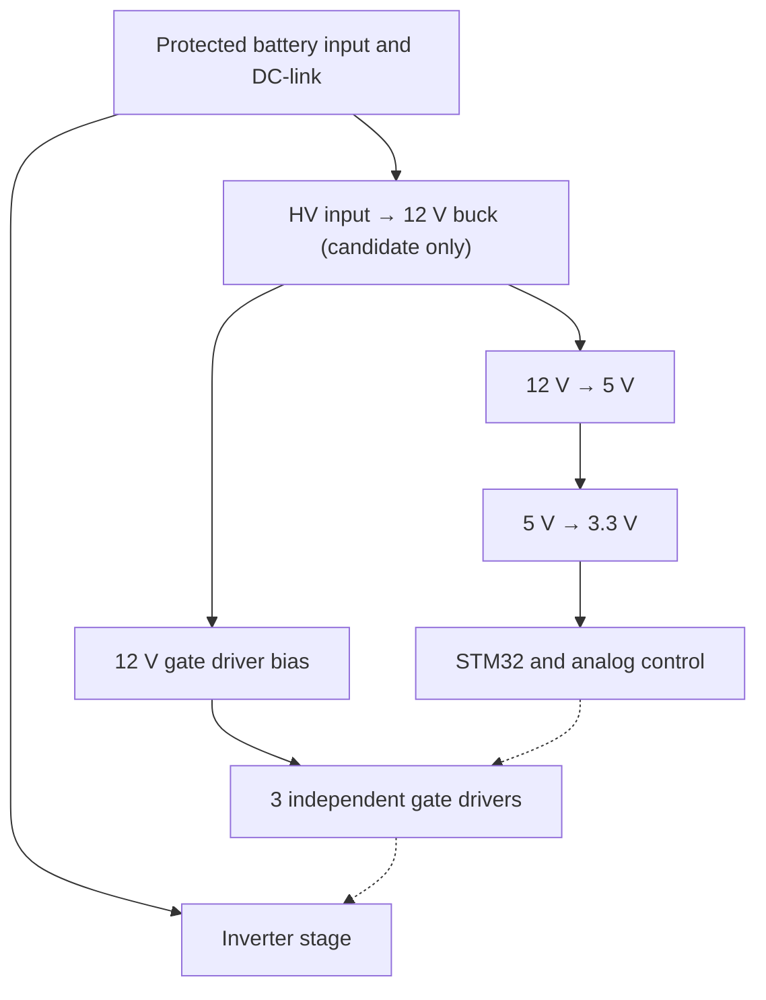

# Power Stage Concept v0.1 — Virtual study

> **Status:** Concept topology, candidate datasheets and virtual numerical results only. NOT an Altium/KiCad pin-level schematic, ERC-checked netlist, SPICE transistor-level validation or manufacturing design.

## Compatibility with existing repo decisions
- Integrated board, 3 half-bridges / 6 N-MOSFET positions, 3 independent high/low side gate drivers, STM32 PWM and hard fault interface.
- Onboard 72 V → 12 V → 5 V → 3.3 V rail architecture; no separate AUX board.
- No CAN, RS485, DRV family, external current-sense or external AUX connector; phase current sense remains on PCB.

## Concept S01 — inverter topology

**Arrow endpoints are abstract functional relationships, NOT physical nets or FET/gate-driver pin-level wiring.** The DC negative return, accurate shunt connections, bootstrap, independent shutdown, and fault handling are not defined by this diagram.

## Concept S02 — integrated power tree

## Candidate datasheets (not an approved purchase BOM)
- N-MOSFET: **Infineon IPF036N15NM6** (150 V, max 3.6 mΩ at 10 V, typical gate charge 69 nC). Actual switching losses/thermal package not evaluated. https://www.infineon.com/part/IPF036N15NM6
- High/low gate driver: **TI UCC27714**, one per phase; bootstrap supply, UVLO and 100% high-side duty remain open. https://www.ti.com/product/UCC27714
- High-input buck: **TI LM5164** (100 V max VIN, 1 A max nominal output); **NOT ACCEPTED** for the 80.6 V traction scenario until regeneration and cable transients are assessed. https://www.ti.com/product/LM5164
- Phase measurement: **TI INA241A-Q1** (–5 V to 110 V common-mode); topology, sample window, fault behavior to be determined. https://www.ti.com/product/INA241A-Q1
- 12-to-5 rail: **TI TPS62175** adjustable step-down (28 V max input, 0.5 A). https://www.ti.com/product/TPS62175
- 5-to-3.3 rail: **TI TLV755P** 3.3 V LDO option (5.5 V max VIN, 0.5 A output). https://www.ti.com/product/TLV755P
- **No** final gate resistors, RC snubbers, phase shunts, HV capacitors, EMI filters, boostrap diodes/caps, footprints or procurement part numbers are set.

## Virtual-only simulation (file: simulation/power-stage/simulate.py)
Model parameters: 72 V source; 20 mΩ source resistance; 1360 µF lumped DC-link with 9 mΩ ESR; 3× ideal complementary inverter with 1.2 µs commanded dead time; 15 kHz PWM; 60 Hz fictional back EMF; phase R=0.15 Ω and L=450 µH; back EMF peak=22 V; modulation 0.86; 60 ms transient with 1 µs timestep.

**Last 1/60 s cycle results**: Vbus mean 71.692 V, min 71.522 V, max 71.887 V, ripple p-p 0.366 V; phase-A RMS 23.826 A; source average 15.388 A, source input power ~1,108 W. These results are for the fictional motor only — they **cannot verify 3.5/5 kW capability**.

The model does **not** include nonlinear power device model, parasitic ringing, actual gate driver, switching or thermal loss, fault response, EMC, regeneration, insulation or physical wiring.

## Before any real design approval
1. Validate actual motor datasheet R/L/back EMF, current envelope and torque-speed data.
2. Set DC link overvoltage margin including regen, transients and DC/DC IC maximum input.
3. Review high/low driver supply/boot refresh, hardware independent all-off, UVLO and firmware failure states.
4. Complete realistic 3-phase sense, ADC aperture, comparator shutdown and traction isolation review.
5. Perform device-level simulation, complete CAD pin-level schematic/ERC, PCB DRC, bus RMS ripple and thermal/EMC analysis under qualified engineering supervision.

**Not for manufacture or connection to a battery.**